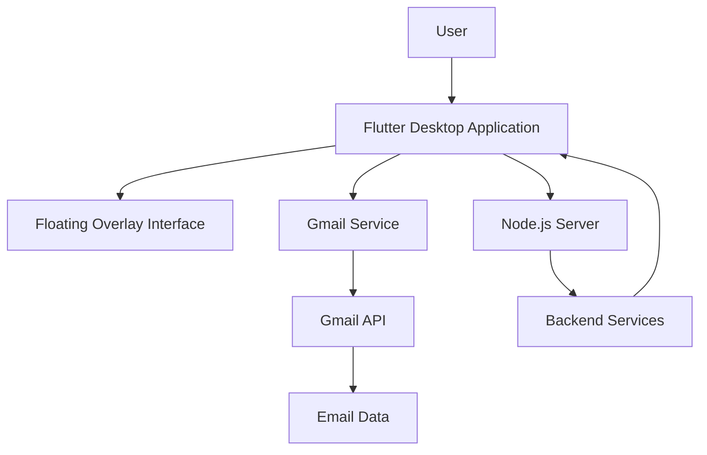

# Mail Agent 📧🤖

### AI-Powered Gmail Assistant & Email Automation

**Mail Agent** is an intelligent email assistant designed to simplify email management and automate repetitive email-related tasks.

Built with Flutter and Node.js, the application combines a desktop interface, Gmail integration, and a backend server to provide an assistant experience directly from the user's workspace.

The project aims to improve productivity by making email interactions faster, more accessible, and easier to manage.

---

## 🚀 Key Features

- **Gmail Integration:** Connect and interact with Gmail services.
- **Email Management:** Access and manage email-related information.
- **Floating Desktop Interface:** Interact with the assistant through an overlay interface.
- **Flutter Application:** Desktop user interface built with Flutter.
- **Node.js Backend:** Server-side functionality and API communication.
- **Email Assistant:** Centralized interface for email-related operations.
- **Modular Architecture:** Separate frontend, backend, and Gmail service components.

## 🏗️ Architecture



## 🛠️ Technology Stack

| Technology | Purpose |
|---|---|
| Flutter | Desktop application interface |
| Dart | Frontend application logic |
| Node.js | Backend server |
| JavaScript | Backend development |
| Gmail API | Gmail integration |
| npm | Backend dependency management |

## 📁 Project Structure

```text
mail_agent/
│
├── lib/
│   ├── main.dart
│   ├── gmail_service.dart
│   ├── overlay_client.dart
│   └── overlay_ui.dart
│
├── server/
│   ├── package.json
│   └── server.js
│
├── pubspec.yaml
├── requirements.txt
├── .env.example
├── .gitignore
└── README.md
```

## 📋 Requirements

- Flutter SDK
- Dart SDK
- Node.js
- npm
- A Google account
- Gmail API credentials and appropriate Google OAuth configuration

## ⚙️ Installation

### 1. Clone the Repository

```bash
git clone https://github.com/med-amine98/mail_agent.git
cd mail_agent
```

### 2. Install Flutter Dependencies

```bash
flutter pub get
```

### 3. Install Backend Dependencies

```bash
cd server
npm install
```

### 4. Configure Environment Variables

Create a `.env` file using `.env.example` as a template.

Add the required API credentials and configuration values.

```env
GROQ_API_KEY=your_groq_api_key
```

Never commit your `.env` file or expose API keys in your source code.

### 5. Start the Backend

From the `server` directory:

```bash
node server.js
```

### 6. Run the Flutter Application

Open a new terminal in the project root:

```bash
flutter run -d windows
```

## 🔄 Application Workflow

1. Launch the Mail Agent desktop application.
2. Connect the application to the required Gmail account.
3. Initialize the backend server.
4. Access the assistant through the floating interface.
5. Interact with the available email management features.
6. Use the assistant to simplify email-related tasks.

## 🔐 Security

Security is an important consideration when working with email accounts and API credentials.

- Keep API keys in environment variables.
- Never upload `.env` files to GitHub.
- Use Google OAuth for Gmail authorization.
- Request only the Gmail permissions required by the application.
- Protect authentication tokens and sensitive email information.
- Avoid exposing credentials in application logs.

## 🔮 Future Improvements

- AI-powered email classification.
- Automatic email summarization.
- Intelligent email response generation.
- Smart inbox organization.
- Automated email prioritization.
- Advanced Gmail search.
- Attachment analysis.
- Voice-controlled email assistant.
- Improved desktop notifications.

## 👨‍💻 Author

**Mohamed Amine Hechmi**

GitHub: [@med-amine98](https://github.com/med-amine98)

Project: [Mail Agent](https://github.com/med-amine98/mail_agent)

---

⭐ If you find this project useful, consider giving the repository a star.

**Mail Agent — Making Email Management Smarter and More Efficient.**
